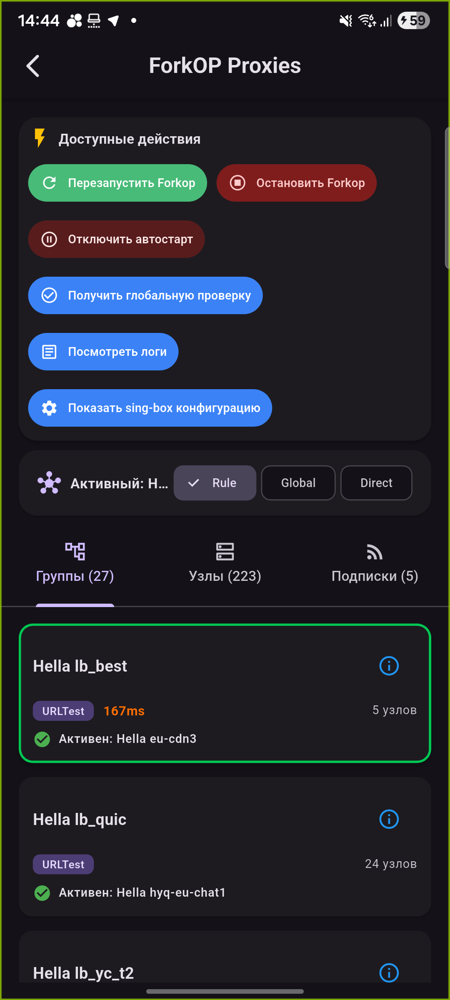

# Проверка VPN на реальном оборудовании — 19.10.2026

Проверены Windows 2.5.20 и Android 2.5.24 на Cudy WR3000S v1 / OpenWrt 25.12.5 с ForkOP и sing-box. Получено 27 групп и 223 сервера из реального роутера.

- Windows: ручной выбор узла через интерфейс подтверждён отдельным чтением Clash API роутера. Фильтры провайдера/протокола формируются из узлов; выбранный провайдер сохраняется после обновления.
- Интеграционный тест сервиса: автоматическая политика и ручной узел подтверждены отдельным чтением API; несуществующая цель отклонена без изменения селекторов; исходные значения восстановлены в finally.
- Android: переход на автоматическую группу, ручной узел и другую группу быстрым выбором подтверждён отдельными SSH-чтениями API. Список участников URLTest открывается как автовыбор.
- APK установлен поверх 2.5.23 с сохранением профиля и подключением к роутеру. Подпись совпадает с установленной версией; arm64 versionCode = 6524.
- После испытаний оба изменяемых Selector восстановлены точно по исходному снимку (0 расхождений). Тема LuCI Proton2025 сохранена и проверена через UCI.

Проверки: Windows 128 passed / 6 skipped; portable core 10 passed / 1 skipped; opt-in live VPN 1 passed; read-only router probes 2 passed; Flutter analyze без замечаний, 163 tests passed. Пропуски offline-прогона относятся к интеграциям, требующим явного включения.

Исправлена блокировка тестов Dashboard при наличии WPF Application без работающего Dispatcher: тесты передают синхронный диспетчер, приложение сохраняет штатный UI Dispatcher.

Пределы проверки: проверялся выбор маршрута через состояние роутера, а не полный захват пользовательского трафика; все 223 узла по отдельности не испытывались. WireGuard/AmneziaWG и новые Linux-пакеты в этом аппаратном прогоне не проверялись. Ранее выполненные Linux-проверки PR не заменяются этим отчётом.

Снимки конфигурации и данные доступа в репозиторий не включены. Для повторения live-теста нужны OPENWRT_LIVE_VPN_SWITCH=1, OPENWRT_TEST_HOST и OPENWRT_TEST_PASSWORD; запуск временно меняет реальный VPN и восстанавливает исходный выбор.

